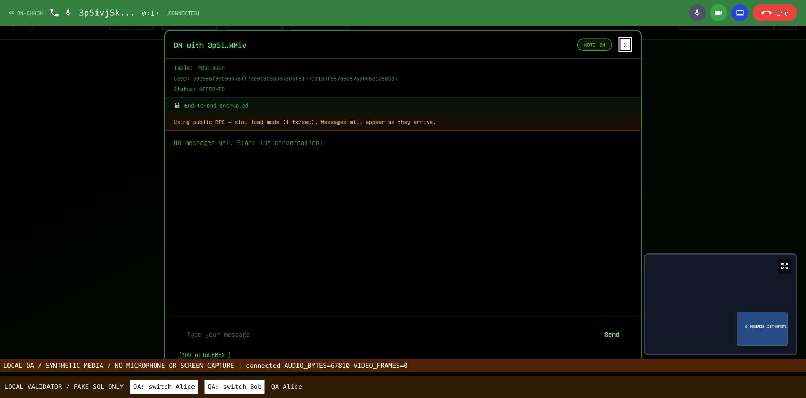
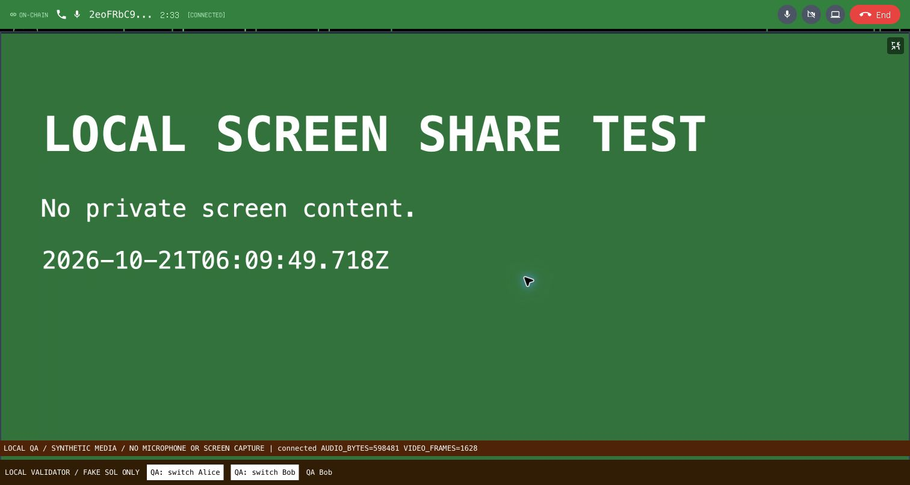

# Calling evidence

Local validator, generated disposable wallets. No mainnet acceptance claimed.

This browser call used synthetic audio/video and actual local-chain signaling.
The receiver decoded video frames and received audio packets (see the peer JSON).
It does not establish human listening or physical-mobile acceptance.

A separate test used the Mac microphone, camera and native Chrome tab sharing.
Only a safe test tab was captured; no microphone recording or camera image was
saved. Camera-off/reacquire and native Stop Sharing were verified. The hangup
receipt records all captured tracks ended and both peer connections closed.

Latest source: 101 tests, TypeScript, calling-code lint and production build pass
with the packed local SDK candidate. Published SDK pin/recheck, physical phone,
human listening and cross-network acceptance remain pending. No TURN is included.
